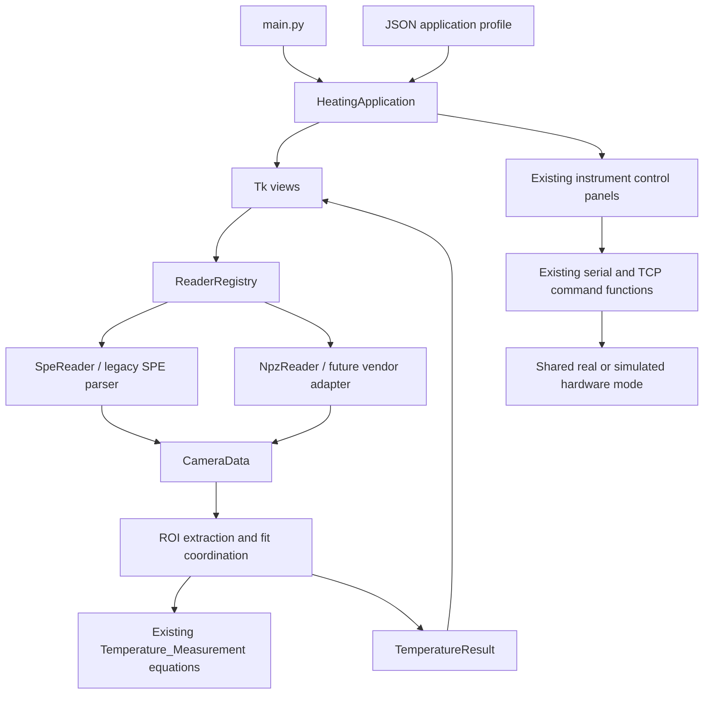

# Architecture assessment and first modular branch

Branch: `refactor/modular-architecture`
Baseline: `c79e8cf` on `main` (watchdog lifecycle fix)
Assessment and validation: October 10, 2026

The most useful boundary is between camera data, scientific analysis, and the
Tk interface. The active program reads camera-exported SPE files; it does not
configure or acquire from the Acton/PIXIS camera through an SDK. This makes a
generic file adapter and camera profile the appropriate first step. Replacing
direct acquisition will need a separate integration when that workflow exists.

This branch implements that first step and restructures startup. It retains
the established temperature equations and existing instrument command code.
It is an incremental refactor, with further hardware and workflow changes
listed below.

## What made the original structure difficult

| Area in the baseline | Finding | Consequence |
| --- | --- | --- |
| `acton_pixis.py` | About 1,000 lines spanning calibration fields, optical relay commands, plotting, SPE loading, folder watching, ROI editing, and temperature-panel assembly | A change to one camera affected several unrelated UI classes in the same file |
| `main.py` | 267 lines, wildcard imports, module globals for connections/windows, and field-by-field updates to individual motor widgets | Window ownership and setting propagation were hard to follow; main filter ports were omitted from COM updates |
| Camera data | SPE single-frame images were arrays; multiple frames were lists | Every consumer had to understand a vendor-specific representation |
| ROI handling | Default 1340-column/70-row geometry and editor bounds were embedded in UI code | Changing a saved image size could silently clip slices or leave invalid editor limits |
| Calibration | CSV entries encode physical relay states; file naming, session date, magnification, and filter combinations matter | Calibration selection must remain tied to an optical setup, not just a camera filename |
| Instrument communication | Serial/TCP calls, timeouts, sleeps, logging, and debug checks live in root modules; some commands are called directly by Tk callbacks | Slow or disconnected devices can stall the interface; hardware replacement requires editing command-level code |
| Motor controls | Keyboard/guide-laser behavior is duplicated between the main motor panel and remote-control window; dead code existed below an image helper's return | Fixes need to be kept consistent across two implementations |
| Repository | 53 compiled `.pyc` files were tracked, alongside the historical `deprecated/` and vendored T-Rax trees | Generated files obscured meaningful changes; active versus historical code lacked an entry-point map |
| Launch and export | `main.bat` starts several older absolute-path installations and an external FLIR program; “Save Temperature Fit” opens a folder chooser | The laboratory launcher and this checkout are separate; fit export is unfinished |

## Structure implemented on this branch

The analysis module imports neither Tk, matplotlib, serial, nor debug/hardware
state. Its data objects can be used by a script, test, or future acquisition
service. The UI consumes the same objects regardless of file format.

| Module | Responsibility |
| --- | --- |
| `laser_heating/models.py` | Capture, ROI, extracted spectrum, temperature result |
| `laser_heating/readers.py` | Reader protocol, registration, SPE and generic NPZ adapters |
| `laser_heating/analysis.py` | ROI extraction, wavelength compatibility, invocation of existing fitting equations |
| `laser_heating/config.py` | Typed camera/hardware/calibration settings and JSON loading |
| `laser_heating/application.py` | Startup, menus, main auxiliary-window ownership, shared connection updates |
| `laser_heating/ui/temperature.py` | Assembly of the temperature panels |
| `laser_heating/ui/calibration.py` | Calibration selection/status and optical relay controls |
| `laser_heating/ui/files.py` | One capture-loading flow for manual and automatic mode; existing watcher lifecycle |
| `laser_heating/ui/plots.py` | Plot rendering, capture replacement, and frame navigation |
| `laser_heating/ui/roi.py` | Image-sized ROI preview, validation, and JSON persistence |

`acton_pixis.py` remains a compatibility import entry point. The exported old
class names still resolve. Internal vendor fields on loaded files have been
replaced by `CameraData`; code that directly accessed `plots.data_file.img`
or `.filename` must use `.frame(index)` or `.source`.

Other improvements included in the branch:

- Absolute application resource paths replace process-wide working-directory
  changes. Startup was verified from outside the repository folder.
- Connections have one owner; changes reach all 12 motor-axis widgets, both
  Festo panels, and the main transmission-filter controls. Laser-control
  windows are rebuilt with changed addresses.
- The previously empty Laser IP menu opens the unified connection dialog.
  Nonfunctional spectrometer menu placeholders are replaced by ROI settings
  and camera-profile information.
- Auxiliary windows other than the existing startup motor/relay panels are
  constructed when opened, instead of created and immediately destroyed.
- Manual loading uses the automatic loader's validated read/fit path. A
  mismatched wavelength grid leaves the previous plotted capture intact and
  reports the error.
- Figures close with their views; queued ROI redraws are cancelled on close.
- Default calibration temperature comes from the profile on the first fit.
- Generated Python caches are ignored and removed from version control.
  Historical source/data and T-Rax attribution remain in place.

## Direct acquisition (added November 2026)

`laser_heating/camera.py` adds a `CameraController` interface with three
implementations: `PicamDriverCamera` (the default: PICAM driver through
pylablib, LightField closed), `LightFieldCamera` (LightField automation through
pythonnet) and `SimulatedCamera` (debug mode). Each writes a file and returns
its path, so captures enter the same reader, validation and fit path as
exported files.

The driver has no spectrograph knowledge. `laser_heating/spe.py` reads a
reference LightField SPE for the per-column wavelengths and the sensor regions,
parses `.lfe` files for the camera settings the driver accepts, and writes
captures as SPE 3.0. The camera reads one unbinned rectangle spanning all
regions; `assemble_image` cuts the regions out (summing if binned). Wavelengths
are therefore only as current as the reference: moving the grating without
choosing a new reference gives wrong temperatures, and the app cannot detect
it.
`laser_heating/ui/camera.py` runs every camera call on one worker thread and
applies results on the Tk thread.

Background subtraction is `analysis.subtract_background`, applied in
`PlotGraphs.update_graphs` to measurements and to raw flatfields collected in
the Camera tab. `fit_temperature` and the Planck equations are unchanged, and
with no background set the results are identical to before. Exposure
normalization is still not applied: measurement and flatfield are compared as
recorded.

Both hardware paths are covered by tests against stand-in objects only.
Neither has been run against the camera, and the `.lfe` parser was written from
the experiment XML embedded in the bundled SPE files, not from a real `.lfe`.
First checks on the instrument with LightField closed: Connect opens the
camera; Acquire writes one 1340x70 SPE into the folder for T-fit and it is
fitted; that SPE opens in LightField with the same wavelength axis and band
positions as a LightField capture of the same source; an `.lfe` loads and the
status line lists what was applied (the ADC setting names are the ones most
likely to be refused).

## Generic camera contract

Every reader returns `CameraData` with:

1. Real detector counts arranged as `(frame, row, column)`. A 2D single frame
   is normalized to that form. The existing SPE adapter preserves counts and
   wavelength data from the legacy parser.
2. One positive, finite, strictly increasing wavelength in **nanometers** per
   image column. A reversed dispersion requires a reader to reverse both
   columns and wavelengths together. The analysis does not guess units.
3. A source path and optional exposure time in seconds. Exposure is carried
   as metadata; the existing fit does not introduce new exposure normalization.

The camera profile describes the dimensions after hardware cropping/binning,
not necessarily the full detector. ROIs use those saved-image coordinates,
zero-based starts and exclusive ends. Bounds must fit the image; invalid
regions are rejected rather than silently clipped by NumPy.

Measurement and reference spectra must use matching wavelength grids. The
comparison permits small numerical serialization differences (`rtol=1e-7`,
`atol=1e-5` nm). There is no implicit interpolation. Regridding, exposure
normalization, dark subtraction, saturation treatment, and a different
calibration model should be separate scientific changes with their own
reference-data validation.

For a new exported-file camera, create a profile, reader if needed, and
compatible calibration captures. No fitting or plotting rewrite is required.
The generic NPZ adapter provides a usable neutral interchange format now.
When using manual calibrations, disable the optical-state table in that
profile so current Acton calibration paths cannot overwrite the new ones.
This changes calibration selection, not physical relay operation.

## Calibration behavior retained

The calibration resolver and its missing-state behavior remain in use. The
default left-side iris is **In**. The right side retains **Out**. Selecting a
state updates each file field to the matching available file, or clears it
and marks it missing. Automatic loading skips a capture when required
calibration files are unavailable. The 64-state selection test still passes,
including aliases, exposure suffixes, raw companions, and misfiled
magnification cases.

Calibration paths and tables now belong to the profile. The existing CSV
layout still describes the current relay wiring. A different camera does not
make those lamp/reference spectra interchangeable: the selected calibration
must match that instrument's wavelength grid and image geometry.

## Validation

All **48 tests passed**:

- 24 new architecture tests cover ROI bounds, frame/data validation, SPE
  single/multi-frame normalization, generic NPZ and custom readers, profile
  paths, wavelength mismatch rejection, current fit equivalence, and real UI
  integration with a different camera.
- 8 calibration tests retain the complete 64-state selection exercise.
- 3 hardware-mode tests verify simulated commands, relay state, and existing
  normal-mode transport selection using mocked transports.
- 13 watchdog tests retain real filesystem-event coverage, renamed and
  partial files, a seven-second paused write, retry recovery, deduplication,
  restart, folder switching, shutdown, and actual fit/redraw.

The generic camera integration uses **96×20 images, two frames, independent
left/right ROIs, NPZ files, and a configured 2100 K reference**. Startup fits
2100 K, navigating the synthetic second frame fits 2300 K, and a new NPZ
arrival is fitted by the real folder watcher. Invalid manual calibration-grid
input retains the prior display. Connection propagation and window reopening
are also exercised.

On the current bundled SPE data, fitted temperature, uncertainty, emissivity,
corrected spectrum, and fitted spectrum agree with direct calls to the
original equations (`rtol=1e-12` in the regression comparison). These checks
verify preservation on representative files; they do not establish a new
scientific model for another detector.

The complete debug GUI was also built from outside the repository directory,
with **62 control callbacks** exercised while serial opens, socket creation,
and COM-port scans raised errors if attempted. No instrument I/O occurred.
Live instrument operation was not exercised during this refactor.

## Next cleanup stages, in order

1. **Instrument services and transport ownership.** Define focused motor,
   relay, and laser interfaces and inject real or simulated implementations.
   Move protocol encoding and serial/TCP resource management behind them;
   remove dependence on global mode/logging state from UI code. Consolidate
   keyboard controls, handle held-key shutdown deliberately, and update
   remote-control-window settings through the same owner. Verify stop/jog and
   relay behavior on the rig before replacing the current drivers.
2. **Acquisition coordinator and background work.** Extract the tested folder
   readiness/deduplication state machine from the Tk frame. Separate incoming
   capture sources from file readers. A future SDK source should emit
   `CameraData`; a directory source can use the current registry. Move slow
   reads/fitting and hardware calls to workers, returning results through a
   queue; keep Tk/matplotlib rendering on the GUI thread. Preserve ordering,
   cancellation, and watcher-generation semantics.
3. **Explicit optical state and calibration catalog.** Represent side, iris,
   magnification, and filter combination independently of relay-bit strings.
   Keep one mapping from optical state to hardware commands and another to
   calibration assets. Add calibration identity/provenance to each result so
   a later filter change cannot obscure which reference produced a plot.
4. **Result persistence.** Implement the current “Save Temperature Fit”
   placeholder as a result-export service. Save frame index, source and
   calibration identities, temperatures, uncertainty, ROIs, profile identity,
   wavelength grid, and raw/corrected/fitted spectra. Use separate acquisition
   and output-folder settings rather than the current shared folder field.
5. **UI and repository finishing.** Consolidate remaining older panel names,
   remove obsolete helpers after checking usage, and replace fixed pixel
   placement with responsive layouts. Decide which laboratory launch commands
   should become explicit launcher configuration. Keep historical/vendor code
   clearly separated from active runtime rather than rewriting or deleting it
   without a purpose.

These stages should be small, independently reviewable changes. Camera-format
support now has a tested boundary, so it can proceed independently of hardware
driver work or changes to the scientific equations.
